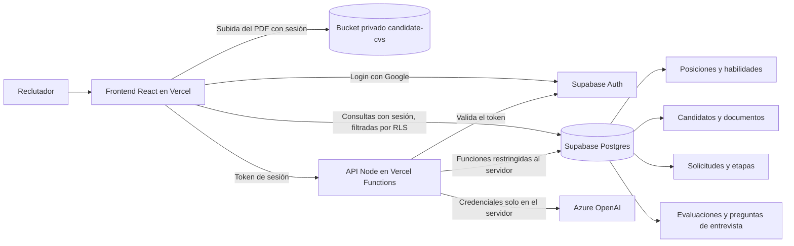

# Talentiq: arquitectura y alcance

**Trabajo práctico:** Inteligencia Artificial Aplicada
**Entrega:** Final
**Grupo:** 2
**Institución:** Universidad Nacional de La Matanza
**Carrera y período:** Ingeniería en Informática, 2026, segundo cuatrimestre

## Integrantes

- Axel Joel Rodriguez Fenske
- Matías Agustín Delgado
- Rafael David Nazareno Ruiz
- Luis Pedro José Melissari
- Lautaro Agustín Terzano

**Repositorio de Azure DevOps:** [Talentiq](https://dev.azure.com/talentiq/talentiq)
**Demo pública:** [https://talentiq-pi.vercel.app/](https://talentiq-pi.vercel.app/)

## Resumen

Talentiq es una aplicación de apoyo a la preselección de candidatos. Cada reclutador autenticado tiene un espacio privado con posiciones persistentes, un banco reutilizable de CVs, solicitudes candidato–posición evaluadas con IA, un ranking por posición, preguntas de entrevista para los candidatos aptos y la posibilidad de descartar candidatos.

La evaluación asistida por IA ayuda a organizar la información, pero no reemplaza la decisión humana de selección.

El detalle de historias y criterios de aceptación está en [alcance-entrega-final-y-historias.md](./alcance-entrega-final-y-historias.md).

## Problema y objetivo

La revisión manual de CVs para distintas búsquedas puede consumir tiempo y producir evaluaciones poco consistentes. Talentiq agiliza la comparación inicial mediante requisitos ponderados y análisis asistido por IA, y facilita el seguimiento de las solicitudes dentro del espacio privado del reclutador.

Los usuarios principales son reclutadores autenticados con Google. Cada reclutador administra sus propias vacantes y su banco privado; no se incluyen empresas, invitaciones ni colaboración entre cuentas. Los candidatos son perfiles cuyos CVs se incorporan al banco del reclutador; no son usuarios de la aplicación.

## Estado actual

La aplicación está desplegada en Vercel y verificada con Supabase y Azure OpenAI reales. Permite:

- Iniciar sesión con Google (Supabase Auth) y trabajar en un espacio privado por reclutador.
- Crear, consultar y editar puestos: nombre, habilidades con peso de 1 a 10, seniority requerido con su peso y porcentaje mínimo de aceptación de 50 % a 100 % (70 % por defecto).
- Abrir o cerrar un puesto. Un puesto cerrado no admite carga ni evaluación de CVs y se oculta de los selectores, salvo que se marque "Incluir cerrados".
- Cargar varios CVs en PDF a la vez desde Postulaciones (hasta 5 MB cada uno). El texto se extrae en el navegador con PDF.js y cada archivo informa su progreso y sus errores sin frenar al resto.
- Consultar el banco privado de candidatos, buscar por nombre o archivo y reutilizar un CV guardado para evaluarlo en otro puesto.
- Ver el ranking de un puesto ordenado por compatibilidad, con fortalezas, brechas y tres preguntas de entrevista para los candidatos aptos.
- Descartar candidatos de un puesto (etapa `Descartado`); se ocultan del ranking y de la lista de evaluados, y se pueden restaurar.
- Al editar un puesto, actualizar las evaluaciones existentes: si solo cambia el porcentaje mínimo se recalcula el veredicto sin llamar a la IA; si cambian habilidades, pesos o seniority se vuelve a evaluar a los candidatos.
- Reutilizar CVs con texto idéntico y evaluaciones cuyo CV, puesto y versión del evaluador no cambiaron, sin volver a llamar a Azure.
- Cambiar entre tema claro y oscuro.

## Alcance de la entrega final

El alcance acordado está implementado, con estas excepciones:

- La etapa `En entrevista` existe en la base de datos, pero todavía no se puede asignar desde la interfaz. La etapa `Descartado` sí está disponible.
- Solo se reconoce como el mismo candidato un CV con texto idéntico; no se detecta a la misma persona cuando sube un CV actualizado.
- No se pueden eliminar candidatos ni documentos desde la aplicación.
- Cada postulación conserva solo su evaluación vigente: al re-evaluar se reemplaza la anterior, por lo que no hay historial completo ni una vista para consultarlo.
- La importación de requisitos desde ofertas de LinkedIn o Computrabajo está implementada en el backend, pero no está conectada al formulario de puestos.

## Reglas de dominio

- La posición tiene su propio estado (`Abierta` o `Cerrada`); el candidato tiene una etapa independiente para cada posición.
- Un candidato puede estar vinculado con distintas posiciones y tener resultados y etapas diferentes en cada una.
- Cada posición y candidato pertenecen a un reclutador; los CVs no se comparten entre cuentas.
- Una solicitud corresponde a una pareja candidato–posición y conserva su evaluación vigente: puntaje, veredicto, fortalezas, brechas, preguntas y fecha.
- Cambiar el estado de la posición no modifica las etapas de los candidatos; re-evaluar un candidato tampoco cambia su etapa.
- Las operaciones sobre datos y archivos validan la autorización en el backend y en las políticas de la base; ocultar elementos en la interfaz no constituye aislamiento.
- La generación de preguntas usa únicamente el cruce candidato–posición evaluado.
- Los errores de persistencia, almacenamiento y servicios de IA se muestran al usuario y no se convierten en resultados con apariencia de éxito.

## Modelo funcional

| Entidad | Responsabilidad y relaciones |
|---|---|
| Reclutador | Usuario autenticado mediante Google y propietario del espacio privado. |
| Posición | Pertenece a un reclutador y conserva requisitos, ponderaciones, umbral de aceptación y estado. |
| Candidato | Perfil del banco privado del reclutador, con nombre y datos de contacto extraídos del CV. |
| Documento de candidato | Archivo CV privado con sus metadatos, texto extraído y huella para detectar CVs idénticos. |
| Solicitud candidato–posición | Vincula un candidato y una posición del mismo reclutador; conserva la etapa del proceso. |
| Ejecución de evaluación | Evaluación vigente de una solicitud, con la versión del evaluador que la produjo. |
| Preguntas de entrevista | Se asocian a la ejecución de evaluación que aporta el contexto del candidato y de la posición. |

La autenticación de Google identifica al reclutador; Talentiq no almacena credenciales de Google. Las tablas y los archivos privados quedan asociados a la identidad autenticada.

## Arquitectura

- **Frontend:** React 19, TypeScript y Vite, desplegado en Vercel. Extrae el texto de los PDF con PDF.js y consulta directamente sus puestos, candidatos y evaluaciones; las políticas RLS garantizan que cada reclutador solo vea lo propio.
- **API:** `server/server.mjs`, publicada como Vercel Functions mediante `api/[...route].mjs`, `api/candidates.mjs` y `api/candidates/lookup.mjs`. Todas sus rutas privadas validan el token de Supabase antes de operar: evaluación (`/api/evaluate-candidate`), persistencia y búsqueda de CVs (`/api/candidates`, `/api/candidates/lookup`), guardado de evaluaciones (`/api/evaluation-runs`) e importación de ofertas (`/api/import-job-requirements`).
- **Base de datos:** las escrituras sensibles (guardar candidatos y evaluaciones) pasan por funciones de la base que solo puede ejecutar el servidor con `SUPABASE_SERVICE_ROLE_KEY`. El guardado de puestos usa una función transaccional que toma la identidad de la sesión.
- **Secretos:** las credenciales de Azure OpenAI y la clave de servicio de Supabase existen solo en el servidor. Al navegador solo llegan las variables `VITE_*` (URL y clave pública de Supabase).

## IA y procesamiento

1. El navegador envía al backend los requisitos del puesto y el texto del CV, con el token de sesión.
2. El backend valida la sesión y busca una evaluación guardada con el mismo candidato, CV, puesto, requisitos y versión del evaluador. Si existe, la reutiliza sin llamar a Azure.
3. Si no existe, Azure OpenAI decide para cada habilidad del puesto si el CV la acredita y cita la evidencia, y decide si el candidato alcanza el seniority requerido. Reconoce sinónimos, abreviaturas, otros idiomas y herramientas que implican la habilidad; no cuenta objetivos de aprendizaje ni herramientas distintas de nombre parecido.
4. El backend calcula el puntaje sumando los pesos de las habilidades acreditadas y el peso del seniority si se cumple, redondea el porcentaje y decide el veredicto con el umbral del puesto. Si la IA omite alguna habilidad, devuelve un error explícito.
5. Para los candidatos aptos se generan tres preguntas de entrevista basadas en el cruce entre el CV y el puesto, y todo se guarda en la base.

El puntaje lo calcula siempre el servidor; el navegador no puede modificarlo. Si Azure OpenAI no está configurado o falla, se informa el error y no hay evaluación local de respaldo. La carga masiva procesa cada CV de forma individual y continúa con los demás ante un fallo. Solo se admiten PDF con texto seleccionable de hasta 5 MB.

## Datos y privacidad

- El texto del CV se extrae en el navegador. El PDF se guarda en el bucket privado `candidate-cvs` y la base conserva sus metadatos, el texto extraído, la huella del contenido y los datos de contacto del candidato.
- Cada posición, candidato, documento, solicitud y evaluación pertenece a un reclutador. Las políticas RLS y la validación de sesión del backend impiden que otra cuenta los consulte o modifique.
- El texto del CV y los requisitos del puesto se envían a Azure OpenAI desde el backend para evaluarlos.
- Las credenciales de Azure OpenAI y la clave de servicio de Supabase son secretos del servidor y no llegan al bundle del navegador.
- No hay eliminación de candidatos ni de documentos desde la aplicación, y no se definieron reglas de consentimiento ni de retención de datos personales.

## Tecnologías

| Área | Tecnología | Uso |
|---|---|---|
| Interfaz | React 19, TypeScript y Vite | Aplicación web autenticada |
| Extracción PDF | `pdfjs-dist` | Lectura del texto de los PDF en el navegador |
| Autenticación, datos y archivos | Supabase | Login con Google, Postgres con RLS y bucket privado de CVs |
| API | Node.js nativo en Vercel Functions | Validación de sesión, evaluación, persistencia de CVs y evaluaciones, importación de ofertas |
| IA | Azure OpenAI | Evaluación por habilidad, seniority, preguntas de entrevista e importación de ofertas |
| Hosting | Vercel | Frontend y API |
| Pruebas | `node --test` y Playwright | Pruebas del backend y end-to-end de la interfaz |
| Lint | Oxlint | Análisis estático |

## Pruebas y despliegue

Las pruebas automatizadas cubren autenticación, puestos y umbral de aceptación, carga masiva con errores independientes, banco de candidatos, ranking, descarte, re-análisis al editar un puesto, cálculo del puntaje, reutilización de evaluaciones y aislamiento por reclutador en el backend. Usan Supabase y Azure simulados.

Además, la evaluación se validó con Azure OpenAI real y con una prueba manual en la aplicación, y el flujo completo se verificó en el despliegue de Vercel con Supabase y Azure reales. El detalle está en [pruebas-y-resultados.md](./pruebas-y-resultados.md).

## Decisiones pendientes

- Consentimiento, retención, exportación y eliminación de CVs y datos personales.
- Tratamiento de CVs escaneados sin texto seleccionable.
- Si en una etapa futura se requerirán empresas, bancos compartidos e invitaciones entre reclutadores.

## Referencias del repositorio

- `PROYECTO-ACTUAL.md`: estado de cada funcionalidad y pendientes.
- `src/App.tsx`: sesión, navegación y edición de puestos.
- `src/components/ApplicationIntake.tsx`: carga masiva y evaluación de candidatos.
- `src/components/PositionRanking.tsx`: ranking y descarte.
- `src/components/CandidateBank.tsx`: banco de candidatos.
- `src/services/extractPdfText.ts`: extracción de texto con PDF.js.
- `src/services/inferCandidateEvaluation.ts`: llamada a la API de evaluación.
- `server/server.mjs`: API autenticada, prompt de evaluación y cálculo del puntaje.
- `supabase/migrations/`: esquema, políticas RLS y funciones de la base.
- `tests/` y `server/server.test.mjs`: pruebas end-to-end y del backend.
- [Alcance e historias de usuario](./alcance-entrega-final-y-historias.md).

## Fuente y criterio de actualización

El estado descripto se contrastó con el código, las migraciones y las pruebas del repositorio, y con la verificación del despliegue informada por el equipo. Actualizar este documento cuando cambie una capacidad, su integración con servicios o su estado de verificación.
